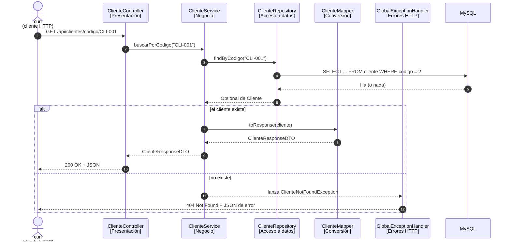

# DAM2-AD-SpringBoot-APIRest — Jorge González Gómez

API REST de **Clientes y Pedidos** con Spring Boot 3, Spring Data JPA y MySQL (Docker, puerto 3307).
Reutiliza las entidades `Cliente`, `Pedido` y `TipoCliente` de la práctica anterior JDBC/JPA.

## 1. Explicación de capas

Arquitectura por capas (separación de responsabilidades, SoC): cada capa solo habla con la siguiente.

`Controller → Service → Mapper / Repository → Base de datos`

| Paquete (`src/main/java/com/jorge/apirest/...`) | Capa | Qué hace |
|---|---|---|
| `controller` (`ClienteController`) | **Presentación** | Recibe las peticiones HTTP, valida el JSON (`@Valid`), llama al service y devuelve el código de estado (200, 201...). Sin lógica de negocio. |
| `service` (`ClienteService`) | **Negocio** | Reglas de la aplicación (código duplicado, cliente inexistente, caso `con-pedido`). `@Service` + `@Transactional`: cada método es una transacción. |
| `mapper` (`ClienteMapper`, `PedidoMapper`) | **Conversión** | Entidad ↔ DTO. El controller nunca expone entidades. |
| `repository` (`ClienteRepository`, `PedidoRepository`) | **Acceso a datos** | Interfaces que extienden `JpaRepository`. Con Spring Data **el repository hace el papel del DAO** (no escribimos clases DAO a mano; Spring genera la implementación y los métodos derivados como `findByActivoTrueOrderByCodigoAsc()`). |
| `entity` (`Cliente`, `Pedido`, `TipoCliente`) | **Modelo / persistencia** | Clases JPA mapeadas a las tablas `cliente` y `pedido`. Relación 1:N bidireccional (`Pedido` es la parte propietaria con `cliente_id`). |
| `dto` (records) | **Transferencia de datos** | Formato de entrada y salida de la API (`ClienteRequestDTO`, `ClienteResponseDTO`, `PedidoRequestDTO`, `PedidoDTO`, `ClienteConPedidoRequestDTO`...). |
| `exception` | **Gestión de errores** | Excepciones de negocio y `GlobalExceptionHandler`, que las traduce a 404, 409 y 400. |

## 2. Diagrama de la pila de llamadas

Método elegido: `GET /api/clientes/codigo/{codigo}`, con el caso correcto (200) y el de error (404).

## 3. Inventario de pruebas ejecutadas

Todas se lanzan con `pruebas\pruebas-curl.ps1` (usa `curl.exe` contra `http://localhost:8080`).
Rellena la columna **Obtenido** con el código que imprime el script y marca ✔ si coincide con el esperado.

| # | Prueba | Petición | Esperado | Obtenido | OK |
|---|---|---|---|---|---|
| 1 | Listar clientes | `GET /api/clientes` | 200 | | |
| 2 | Listar activos ordenados por código | `GET /api/clientes/activos` | 200 | | |
| 3 | Cliente por código existente | `GET /api/clientes/codigo/CLI-001` | 200 | | |
| 4 | Cliente por código inexistente | `GET /api/clientes/codigo/NOEXISTE` | 404 | | |
| 5 | Clientes de tipo EMPRESA | `GET /api/clientes/empresa` | 200 | | |
| 6 | Pedidos de un cliente | `GET /api/clientes/1/pedidos` | 200 | | |
| 7 | Pedidos de cliente inexistente | `GET /api/clientes/99999/pedidos` | 404 | | |
| 8 | Crear cliente | `POST /api/clientes` | 201 | | |
| 9 | Crear cliente con código repetido | `POST /api/clientes` | 409 | | |
| 10 | Crear cliente sin código | `POST /api/clientes` | 400 | | |
| 11 | Crear pedido a cliente existente | `POST /api/clientes/1/pedidos` | 201 | | |
| 12 | Crear pedido a cliente inexistente | `POST /api/clientes/99999/pedidos` | 404 | | |
| 13 | Crear pedido con total negativo | `POST /api/clientes/1/pedidos` | 400 | | |
| 14 | Cliente nuevo + pedido en una petición | `POST /api/clientes/con-pedido` | 201 | | |
| 15 | `con-pedido` con cliente ya existente (no lo duplica) | `POST /api/clientes/con-pedido` | 201 | | |
| 16 | `con-pedido` sin pedido | `POST /api/clientes/con-pedido` | 400 | | |

Además hay 16 tests automáticos (`ClienteApiTest`, MockMvc + H2) que cubren los mismos casos: `mvn test`.

## 4. Cómo ejecutar

1. Base de datos: `docker compose up -d` en `07-JDBC-JPA\docker-mysql` (MySQL en el puerto 3307, datos de ejemplo).
2. API: abrir `apirest` en IntelliJ y ejecutar `ApiRestApplication`, o `mvn spring-boot:run`.
3. Probar: `curl.exe -i http://localhost:8080/api/clientes`

## 5. Evidencias

Carpeta `evidencias/`: capturas de pantalla completa con `curl.exe -i` (se ve el código de estado HTTP).
